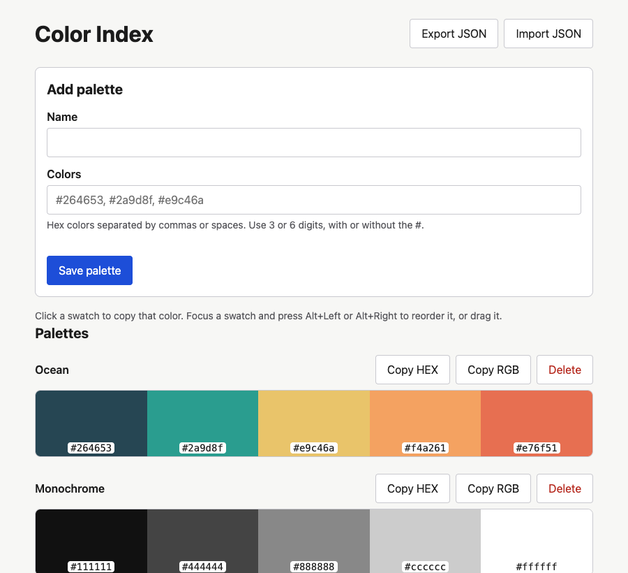

# Color Index

Store color palettes in your browser and copy them to the clipboard as code-ready lists, for creative coding (p5.js, Processing, Python, shaders).



## Features

- Add palettes from hex colors (`#264653, #2a9d8f` or `abc 123456`; `#` optional, 3 or 6 digits).
- **Copy HEX** gives `["#264653","#2a9d8f"]`; **Copy RGB** gives `[(38,70,83),(42,157,143)]`. Click a swatch to copy a single color.
- Reorder colors by dragging, or with `Alt+Left` / `Alt+Right` on a focused swatch.
- Palettes persist in `localStorage`; export and import as JSON.
- Keyboard accessible, with visible focus, live-region feedback, light/dark themes and `prefers-reduced-motion` support.

## Develop

Requires Node 20 or newer.

```sh
npm install
npm run dev      # dev server
npm test         # unit tests (vitest)
npm run lint     # eslint + prettier check
npm run build    # type-check + production build into dist/
npm run preview  # serve dist/
```

## Deploy and CI

Ready-made GitHub Actions workflows live in `docs/workflows/` (`ci.yml`: lint, test, build; `pages.yml`: build and publish `dist/` to GitHub Pages). They could not be pushed to `.github/workflows/` by the automation that prepared this branch, so move them there yourself:

```sh
mkdir -p .github/workflows && git mv docs/workflows/*.yml .github/workflows/
```

Then set Pages source to "GitHub Actions" in the repo settings. The build uses a relative base, so it works from any sub-path.

## Data format

Export produces an array of `{ "id": string, "name": string, "colors": string[] }`. Import accepts the same shape (and the legacy comma-separated `colors` string) and appends to existing palettes.

## Notes

Version 1 stored palettes in Airtable through an Express server. That backend was removed so the app is static and hostable on Pages; see the pull request for details.
